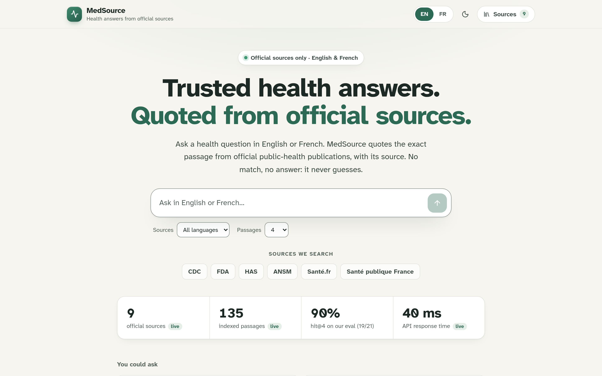
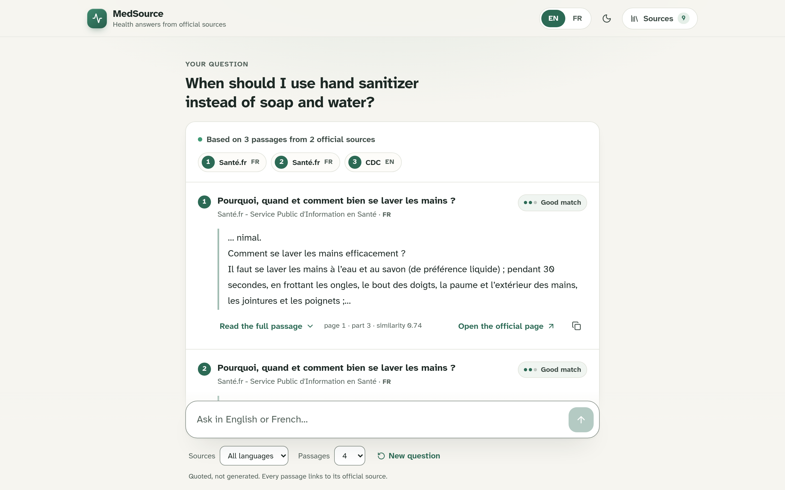
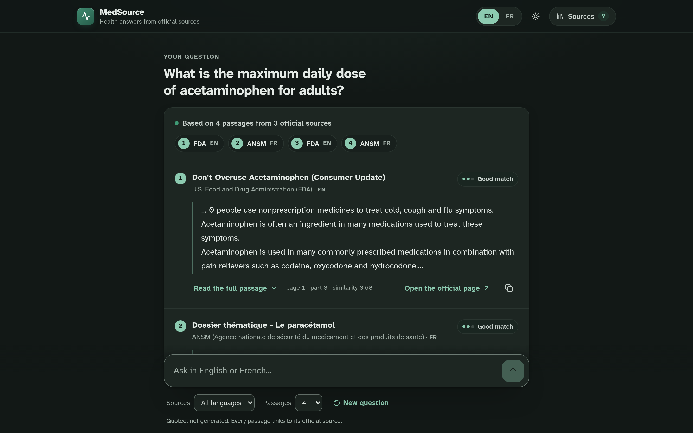
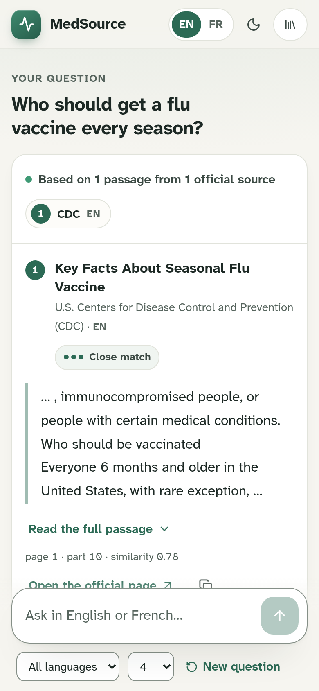
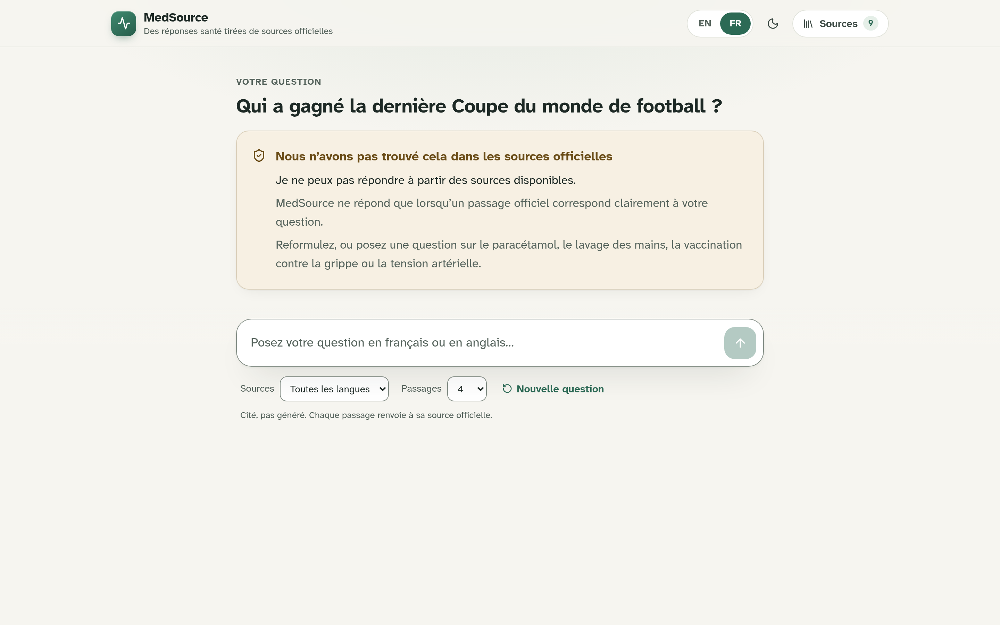
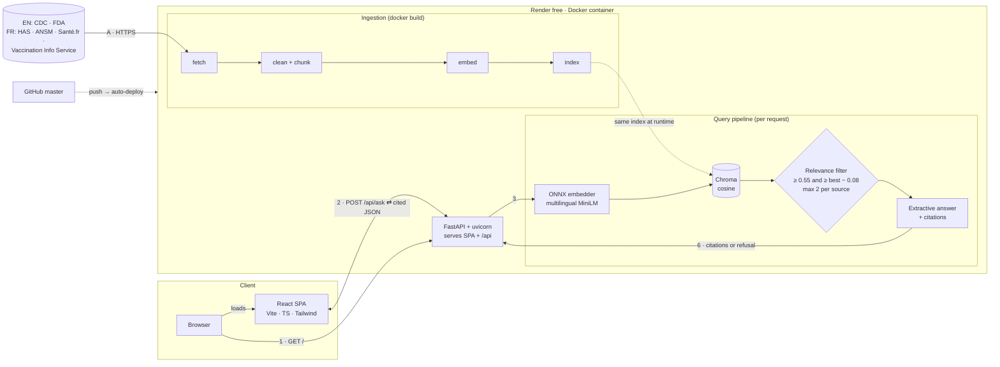
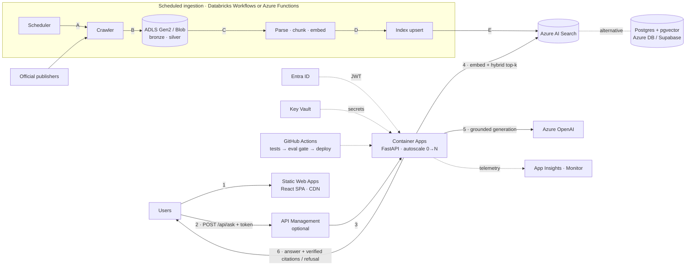

# MedSource RAG (healthcare-rag)

**🔗 Live demo: <https://medsource-rag.onrender.com>** (free Render instance; the first request after idle can take about a minute) · [Architecture](#architecture-current) · [Azure target design](#scaling-to-production-on-azure-target-design--not-deployed) · [Français](#en-bref-français)



> **⚠️ Not medical advice.** Demo / portfolio project: answers are excerpts of public
> documents that may be outdated. Always consult a health professional.
> *Pas un avis médical : projet de démonstration ; consultez toujours un professionnel de santé.*

**MedSource RAG** is a zero-cost **RAG (Retrieval-Augmented Generation)** pipeline that answers
health questions **only** from official public-health documents, and cites the exact source
passage (document, page, chunk, similarity score). The corpus is bilingual: **U.S. federal
sources in English (CDC, FDA)** and **French public sources (HAS, ANSM, Santé.fr, Santé
publique France)**. A multilingual embedding model lets you ask in English or French and
retrieve passages in either language (cross-lingual search). No LLM by default, no API keys,
no paid API: it runs on a laptop or on Render's free plan.

### En bref (français)

MedSource RAG répond aux questions de santé **uniquement** à partir de documents officiels
(CDC, FDA en anglais ; HAS, ANSM, Santé.fr, Santé publique France en français) et cite le
passage exact. Vous pouvez poser la question en français ou en anglais : le modèle
d'embeddings multilingue retrouve les passages dans les deux langues. L'interface suit la
langue du navigateur (anglais par défaut) et propose un bouton FR/EN.

## Quickstart

```bash
python -m venv .venv
source .venv/bin/activate
pip install -e ".[dev]"            # or: pip install -r requirements.txt && pip install -e .

python -m healthcare_rag fetch     # download official sources into data/public/raw/ (git-ignored)
python -m healthcare_rag ingest --data-dir data/public/raw --reset
python -m healthcare_rag ask "What is the maximum daily dose of acetaminophen for adults?" -k 4
python -m healthcare_rag ask "Combien de temps faut-il se laver les mains ?" -k 4

pytest                             # offline tests, no model download

pip install -e ".[ui]"             # optional: Streamlit demo
streamlit run src/healthcare_rag/app.py
python -m healthcare_rag eval -k 4 # small retrieval evaluation (see below)
```

The first `ingest`/`ask` downloads the free multilingual embedding model
`paraphrase-multilingual-MiniLM-L12-v2` as an ONNX export (~470 MB, once) and runs it with
**onnxruntime — no PyTorch**. Afterwards you can work offline with `HF_HUB_OFFLINE=1`.
Fully offline demo without any model: add `--embedder hashing` to both `ingest` and `ask`
(lexical baseline only).

### Embedding backends

| `--embedder` / `HEALTHCARE_RAG_EMBEDDER` | Install | Notes |
| --- | --- | --- |
| `onnx` (default) | base install | onnxruntime + SentencePiece, fp32 ONNX weights memory-mapped (external data). Same vectors as sentence-transformers (cosine 1.000000 on our checks), API peak RAM ≈ 300 MB |
| `onnx` + `HEALTHCARE_RAG_ONNX_VARIANT=int8` | base install | int8 export, lower RAM, slightly lower quality (hit@4 8/10 instead of 9/10 on the earlier French-only question set; not re-measured on the bilingual set) |
| `st` | `pip install -e ".[st]"` | sentence-transformers + PyTorch (reference implementation, much heavier install and RAM) |
| `hashing` | base install | deterministic lexical baseline used by the tests |

Why it is lean: the Hugging Face `tokenizer.json` of this 250k-token multilingual model
costs ~285 MB of RAM, so the ONNX backend uses the original XLM-R
`sentencepiece.bpe.model` with the fairseq id mapping (identical ids on all 602 corpus
lines and questions tested, ~95 MB); and the ONNX weights are converted once to external
data so onnxruntime memory-maps them and only the embedding rows actually used are paged
in. Switching backend requires `ingest --reset`.

Example output (an English question answered from a French source: cross-lingual retrieval):

```console
$ python -m healthcare_rag ask "How long should I wash my hands?"
[1] santefr_lavage_des_mains.txt p.1, chunk 3 (score 0.87)
Comment se laver les mains efficacement ?
Il faut se laver les mains à l’eau et au savon (de préférence liquide) ; pendant 30 secondes, ...
```

With `source_lang="en"` (API) or **Sources: EN** (UI), the same question cites the CDC page
instead (scores 0.61 and 0.60). Off-topic questions are refused:
`I cannot answer from the available source passages. Je ne peux pas répondre à partir des sources disponibles.`

## Web app (FastAPI + React)

A single-page app (Vite + React 19 + TypeScript + Tailwind CSS v4, self-hosted Atkinson
Hyperlegible Next font) served by a FastAPI backend that wraps the same pipeline. The
embedding model and the index are loaded once per process, so a question takes tens of
milliseconds after start-up.

```bash
pip install -e ".[api]"
cd frontend && npm ci && npm run build && cd ..
uvicorn healthcare_rag.api:app --port 7860        # http://localhost:7860 (no PyTorch needed)
# frontend dev server with hot reload (proxies /api to :7860): cd frontend && npm run dev
```

API:

| Endpoint | Description |
| --- | --- |
| `GET /api/health` | status, number of indexed chunks, embedding model |
| `GET /api/sources` | the official documents (title, publisher, URL, `lang`) |
| `POST /api/ask` `{"question": "...", "k": 4, "source_lang": null}` | `refused`, refusal `message` in `en` and `fr`, `citations[]` (rank, source, title, publisher, url, `lang`, page, chunk_index, score, text), `took_ms`. Optional `source_lang`: `"en"` or `"fr"` to cite only sources in that language |

UI features: a calm, light-by-default interface (sage on warm off-white, muted dark mode),
set in Atkinson Hyperlegible Next at 17 px. The first screen states the value proposition,
lists the publishers searched (CDC, FDA, HAS, ANSM, Santé.fr, Santé publique France) and shows
key figures: source and passage counts and the API round-trip are **read live from the running
service** at page load; hit@4 (19/21, 90 %) is the result of `python -m healthcare_rag eval -k 4`
on 2026-10-21, kept in `frontend/src/evalResult.ts`. Answers open with numbered source chips
(publisher + EN/FR) that jump to the quoted passages; each passage shows a plain-language
match level, page/fragment, raw similarity, expand, copy and a link to the official page.
Refusals and errors have their own calm states. The official sources and index settings live
in a slide-over panel. **English-first**: the UI language follows the browser (`fr*` → French,
anything else → English) and the EN/FR toggle remembers the choice; there are suggested
questions and a refusal message per language and a source-language filter (All / EN / FR).
Accessibility: axe-core (WCAG 2.2 A/AA + best practices) reports 0 violations on the home,
answer and sources views, light and dark, desktop and 390 px mobile; motion (card rise,
breathing loader, drawer slide) only runs without `prefers-reduced-motion`; no horizontal
scroll down to 320 px.

| Answer (light) | Answer (dark) | Mobile | Refusal (FR) |
| --- | --- | --- | --- |
|  |  |  |  |

Older screenshots (`docs/v2_*`, `docs/v3_*`) show the previous UI.

### Deploy for free on Render (Docker)

The `Dockerfile` is a multi-stage build without PyTorch: `node:22-slim` builds the
frontend, then `python:3.12-slim` installs the API, downloads the official sources from
their URLs, prepares the ONNX model and embeds the corpus **at build time**, and serves
everything with uvicorn on `$PORT` (Render injects it; default **10000**), as uid 1000.

Measured locally with the same steps (no Docker), with the bilingual 135-chunk index: API
peak RAM (VmHWM) **≈ 295 MiB** after model load and 210 queries (fits the 512 MB free instance), ~5–20 ms per question locally (≈0.2 s round-trip on Render when warm).

1. Fork/push this repository to GitHub.
2. On [Render](https://render.com): **New → Blueprint**, select the repository; it reads
   [`render.yaml`](render.yaml) (free plan, Docker runtime, health check `/api/health`,
   `HEALTHCARE_RAG_THREADS=1`). Or create a **Web Service** with runtime *Docker*.
3. Wait for the build (sources + model download), then open the service URL.

Free instances sleep after ~15 minutes without traffic; the next request wakes the
service (cold start of tens of seconds). Any other Docker host works too:

```bash
docker build -t medsource-rag .
docker run -p 10000:10000 medsource-rag     # http://localhost:10000
```

## Streamlit demo (fallback)

```bash
pip install -e ".[ui]"
streamlit run src/healthcare_rag/app.py      # http://localhost:8501  (?q=... pre-fills the question)
```

Question box, top-k slider, cited passages with source / page / chunk / score, refusal
message, sidebar disclaimer and source list. The embedding model and the Chroma index are
cached with `st.cache_resource`, so only the first question pays the model-loading cost.

| Cited answer | Off-topic refusal |
| --- | --- |
|  |  |

## Evaluation

`eval/questions.jsonl` holds 25 questions written by the author from the 9 official
documents: 14 in French and 11 in English. 21 are answerable (each with its expected source
file, or a list of acceptable files) and 4 are off-topic (expected refusal: 2 FR, 2 EN).
4 questions are **cross-lingual**: an English question whose only expected source is French
(2), and a French question whose only expected source is English (2).

```bash
python -m healthcare_rag eval -k 4
```

- **hit@k** = share of answerable questions whose expected source is among the cited
  passages (after the relevance filter).
- **refusal accuracy** = share of off-topic questions that were refused.

Result on 2026-10-21 (default ONNX model, `k=4`, `MIN_SCORE=0.55`, `SCORE_MARGIN=0.08`,
`MAX_PER_SOURCE=2`, 135 chunks):

| Questions | hit@4 | False refusals | Refusal accuracy |
| --- | --- | --- | --- |
| English | **8/9 = 0.89** | 0 | **2/2** |
| French | **11/12 = 0.92** | 1 | **2/2** |
| Cross-lingual (subset) | 4/4 | 0 | – |
| **Overall** | **19/21 = 0.90** | 1 | **4/4 = 1.00** |

The two misses:

- *"How long should I scrub my hands when washing them?"* cites the French Santé.fr page
  (score 0.86), which does answer it (30 s), but not the expected CDC page (20 s; best CDC chunk 0.63,
  outside the 0.08 margin). Use the EN source filter to get the CDC passage.
- *« Comment réaliser une automesure tensionnelle à domicile ? »*: the HAS section on home
  self-measurement is not retrieved (best score 0.47), so the system refuses rather than cite a
  weak passage. This was already the miss before the English sources were added.

**Thresholds were retuned when the English sources were added.** With the previous defaults
(`MIN_SCORE=0.6`, no per-source cap) the same set gave EN 6/9, FR 10/12, overall 16/21,
refusals 4/4. Correct English passages often scored 0.58–0.59, and one long CDC page could
fill the whole top 4 and push out the French answer. Lowering the floor to 0.55 and allowing
at most 2 passages per document fixed both. Diagnostic off-topic probes (not in the eval
file) scored ≤ 0.38, and uncovered health questions (ibuprofen, sprain, sunburn) scored ≤ 0.44,
so there is still a gap below 0.55. The thresholds were tuned on this same small set, so the
numbers are optimistic: treat it as a smoke test, not a benchmark.

## EN – The problem

Finding reliable information in long official health documents is slow, and general
chatbots can hallucinate. This project only answers from a curated corpus of official
sources (English and French) and always cites the exact passage, so every answer can be
checked.

## FR – Le problème

Les soignants et les patients perdent du temps à chercher une information fiable dans
des documents de santé longs (recommandations HAS, pages ANSM, CDC, FDA, etc.). Un chatbot
généraliste peut inventer des réponses, ce qui est dangereux en santé. Ce projet répond
uniquement à partir d'un corpus de sources officielles et cite le passage exact, pour que
chaque réponse soit vérifiable.

## Architecture (current)

> What is actually deployed today: one Docker container on Render's free plan, no paid API.
> *Ce qui tourne réellement aujourd'hui : un seul conteneur Docker sur Render (offre gratuite).*


<sub>Sources: [`docs/architecture/current-architecture.svg`](docs/architecture/current-architecture.svg) ·
regenerate with `python docs/architecture/make_diagrams.py --png`.</sub>



### Request flow

1. The browser loads `GET /`; FastAPI serves the built React SPA (static files).
2. The SPA sends `POST /api/ask` with the question (and an optional `source_lang` filter) and gets cited JSON back.
3. The question is embedded locally (ONNX Runtime, multilingual MiniLM-L12, 384 dims, no torch).
4. Chroma returns the nearest chunks (cosine similarity). They are over-fetched, then at most `MAX_PER_SOURCE` (2) chunks are kept per document, plus the optional language filter, down to top-k.
5. The relevance filter keeps passages with score ≥ `MIN_SCORE` (0.55) **and** ≥ best − `SCORE_MARGIN` (0.08); otherwise the system refuses.
6. The extractive answerer returns the exact passages with source, page and score. There is no LLM and no text generation.

The model and the index are loaded once per process. Measured: about 295 MiB peak RAM with the 135-chunk bilingual index (the free instance has 512 MB) and a warm answer in about 0.2 s round-trip from a client.

### Ingestion flow

- **A. fetch:** download the 9 official URLs: 5 English (CDC ×3, FDA ×2) and 4 French (HAS, ANSM, Santé.fr, Vaccination Info Service). PDFs are kept as-is; for HTML, only the main text is extracted.
- **B. clean + chunk:** PDF de-hyphenation, then 800-character chunks with 150 overlap and stable IDs (source, page, chunk index).
- **C. embed:** the same ONNX model as at query time, in batches of 16, L2-normalised.
- **D. index:** upsert into Chroma (135 chunks today).

This runs **during `docker build`**, so the index is baked into the image. Third-party documents are downloaded at build time and never committed to Git.

### Modules

| Module | Role |
| --- | --- |
| `sources.py` | Registry of official sources with their language (`fr`/`en`), `fetch` downloader (PDF as-is, HTML -> main text via trafilatura) |
| `ingestion.py` | `.txt`/`.md`/`.pdf` loading, page split, overlapping chunks with stable IDs |
| `embeddings.py` | ONNX Runtime embedder (default), optional sentence-transformers embedder, hashing embedder for tests |
| `vector_store.py` | Persistent local Chroma collection (cosine similarity) |
| `retrieval.py` | Top-k nearest passages |
| `answer.py` | `ExtractiveAnswerer` (default, no LLM, relevance filter) and `LLMAnswerer` interface (stub for a local LLM such as Ollama) |
| `pipeline.py`, `cli.py` | `fetch`, `ingest`, `ask`, `eval` commands |
| `evaluation.py` | hit@k / refusal-accuracy evaluation on a JSONL question set, per language and cross-lingual |
| `api.py` | FastAPI backend (`/api/ask`, `/api/health`, `/api/sources`) + static frontend |
| `app.py` | Streamlit demo UI (fallback) |
| `frontend/` | React + TypeScript + Tailwind single-page app |

### Relevance filter

Before filtering, at most **`MAX_PER_SOURCE`** passages (default 2) are kept per document, so
one long page cannot fill the whole top-k. A retrieved passage is then cited only if its cosine
score is **≥ `MIN_SCORE`** (absolute floor, default 0.55) **and ≥ best score − `SCORE_MARGIN`**
(default 0.08). If nothing passes, the system refuses to answer. The thresholds are heuristics
tuned on the demo corpus (see [Evaluation](#evaluation)); they do not guarantee relevance.

## Scaling to production on Azure (target design – not deployed)

> **⚠️ This is a target design, not deployed.** It shows how the demo would scale; no Azure
> resources exist for this project. *Architecture **cible**, non déployée : elle décrit comment
> passer du démonstrateur à un service à grande échelle.*


<sub>Source: [`docs/architecture/azure-target-architecture.svg`](docs/architecture/azure-target-architecture.svg).</sub>



| Component | Role in MedSource | Why this choice |
| --- | --- | --- |
| **Azure Static Web Apps** | Hosts the React SPA, with a preview environment per PR | Global CDN for static files; the frontend is decoupled from API scaling |
| **Azure Container Apps** | Runs the FastAPI image (retrieve → filter → generate → verify citations) | The same Docker image as today; HTTP/KEDA autoscaling with scale-to-zero; no Kubernetes to operate |
| **Azure AI Search** | Vector + BM25 hybrid search, semantic ranker, metadata filters (source, date, audience) | Managed index at scale; hybrid search helps with exact drug names and doses |
| *alt.* **Postgres + pgvector** (Azure Database for PostgreSQL or Supabase) | Same role as AI Search | Cheaper start; vectors live next to relational metadata; SQL the team already knows |
| **Databricks Workflows** *or* **Azure Functions** | Scheduled crawl → parse → chunk → embed → upsert | Databricks for large or Spark-heavy re-processing; Functions (timer trigger) for a small corpus |
| **ADLS Gen2 / Blob Storage** | Raw documents (bronze) and cleaned text and chunks (silver), versioned | Reproducible re-indexing, audit trail, licence and provenance kept per document |
| **Azure OpenAI** | Embeddings, plus a chat model that answers **only** from retrieved passages | Grounded generation in Azure data residency. Each sentence must map to a cited passage, otherwise the system refuses |
| **Microsoft Entra ID** | User sign-in (External ID) and managed identities for services | No secrets in code; access per user or role |
| **Azure Key Vault** | API keys and connection strings | Read through managed identity; rotation without redeploy |
| **Application Insights / Azure Monitor** | Traces, latency, refusal rate, token usage, cost alerts | Watch answer quality and spend, not only uptime |
| **GitHub Actions** | CI/CD: tests → **automatic eval gate** → build → push to ACR → new revision | Blocks a release if hit@k, refusal accuracy or faithfulness on the golden set drop below the baseline |
| *optional* **API Management** | Rate limits, quotas, API keys, response cache, request logging | Only if the API is opened to partners or needs per-client quotas |

### Cost drivers (no prices – check the Azure pricing calculator)

These are the main factors behind the bill. No figures are given here on purpose: prices depend on the region, the tier and usage.

- **Azure OpenAI tokens:** this is usually the largest variable cost. It grows with question volume × (prompt context + answer length). Levers: fewer and shorter passages in the prompt, a smaller model, caching of frequent answers.
- **Embeddings:** re-embedding the whole corpus costs much more than incremental updates. Embed only new or changed documents (content hash).
- **Search tier:** AI Search is billed per provisioned unit (replicas × partitions), even when idle. Postgres + pgvector, or Supabase, is cheaper at small scale.
- **Container Apps:** billed on vCPU/memory-seconds and requests. Scale-to-zero makes idle time almost free but adds cold starts; a minimum of 1 replica removes cold starts but costs money while idle.
- **Ingestion compute:** Databricks cluster time (DBUs + VMs), or Functions executions. Schedule it, and use job clusters that shut down.
- **Storage and egress:** usually small for a text corpus; it grows with document versioning.
- **Monitoring ingestion:** App Insights / Log Analytics bill per GB ingested. Sample traces and set retention.
- **API Management tier:** a fixed monthly cost for most tiers, which is why it is marked optional.

### Migration steps (from this repo to Azure)

1. **Containers:** push the existing Docker image to Azure Container Registry and run it on Container Apps, unchanged except config from env vars.
2. **Frontend:** move `frontend/dist` to Static Web Apps and point it at the API (CORS or a linked backend).
3. **Storage:** move `fetch` output to ADLS/Blob (bronze), with cleaned chunks in silver, instead of baking them into the image.
4. **Vector store:** add a `VectorStore` implementation for AI Search (or pgvector) next to `ChromaVectorStore`, and index the same chunk IDs and metadata.
5. **Ingestion job:** schedule `fetch → ingest` as a Databricks Workflow or a timer-triggered Function, and only re-embed documents whose content hash changed.
6. **Embeddings:** keep the local ONNX model, or switch to Azure OpenAI embeddings and re-index everything (the vector spaces are not compatible).
7. **Generation:** implement `LLMAnswerer` with Azure OpenAI and keep the relevance filter, plus a post-check that every sentence is supported by a cited passage.
8. **Security:** Entra ID sign-in, managed identities, secrets in Key Vault, and optionally API Management in front.
9. **Observability:** App Insights with OpenTelemetry; dashboards for latency, refusal rate and tokens.
10. **CI/CD:** GitHub Actions with OIDC to Azure. Run `pytest` and `healthcare-rag eval` as a **blocking gate** (fail below the current baseline), then deploy a new revision with traffic splitting.

## Data

- `data/public/SOURCES.md` lists the 9 official documents (title, publisher, URL, language,
  retrieval date, reuse terms as stated by each publisher):
  - **English (U.S. federal, public domain as stated by each agency):** CDC: handwashing,
    seasonal flu vaccine key facts, high blood pressure. FDA: acetaminophen safe use, and
    "Don't Overuse Acetaminophen".
  - **French:** HAS & SFHTA (hypertension memo, PDF), ANSM (paracetamol), Santé.fr (hand
    washing), Vaccination Info Service / Santé publique France (flu vaccination).
- **These third-party documents are not included in this repository.** Run
  `python -m healthcare_rag fetch` to download them from their original URLs into
  `data/public/raw/` (git-ignored). Their content belongs to their publishers.
- **CDC / FDA notice:** excerpts are quoted unchanged, with attribution ("Source: CDC" /
  "Source: FDA"), and are available at no charge on cdc.gov and fda.gov. Reference to these
  materials does not constitute or imply endorsement of this project by the U.S. Government,
  the Department of Health and Human Services (HHS), the Centers for Disease Control and
  Prevention (CDC) or the Food and Drug Administration (FDA).
- `data/sample/` contains short **fictional** sample texts written for tests and demos
  (clearly labelled, not official, not medical advice).

## Configuration

Environment variables prefixed with `HEALTHCARE_RAG_`:

| Variable | Default |
| --- | --- |
| `MODEL_NAME` | sentence-transformers/paraphrase-multilingual-MiniLM-L12-v2 |
| `PERSIST_DIR` | .chroma |
| `COLLECTION_NAME` | healthcare_rag |
| `CHUNK_SIZE` / `OVERLAP` | 800 / 150 characters |
| `TOP_K` | 4 |
| `MIN_SCORE` | 0.55 (cosine similarity floor) |
| `MAX_PER_SOURCE` | 2 (passages per document in the top-k; 0 = no cap) |
| `SCORE_MARGIN` | 0.08 (max gap to the best passage) |
| `EMBEDDER` | onnx (`st`, `hashing`) |
| `ONNX_VARIANT` | fp32 (`int8`) |
| `MODEL_DIR` | ~/.cache/healthcare-rag (prepared ONNX model) |
| `THREADS` | onnxruntime default (set 1 on tiny instances) |

Notes: text-based PDFs only (no OCR); use `--reset` after changing documents, chunk
settings or the embedder; `SOURCES.md`/`README.md` files are never indexed.

## Limits

- Extractive only: the answer is the cited passages, not a synthesized sentence.
- PDF text is lightly cleaned (end-of-line hyphenation such as `néces-`/`site` is re-joined), but
  some mid-line splits remain (e.g. `diurét ique`).
- Sources can change or move online; `fetch` reports failures per document. Some sites
  (e.g. cdc.gov) reject browser-like user agents, so `fetch` identifies itself honestly as
  `healthcare-rag/0.2`.
- Cross-lingual retrieval works, but sometimes ranks a passage in the other language first
  (e.g. an English hand-washing question gets the French page). Use the source-language filter
  when you need one language.
- The English sources describe **U.S.** recommendations and the French ones describe **French**
  recommendations; they can differ (e.g. 20 s vs 30 s hand washing, a 4 g vs 3 g daily
  paracetamol limit).
- Citations prove traceability, not medical correctness.

## License

Code: [MIT](LICENSE) © 2026 El Bachir Mourabit. The MIT license covers the code only,
not the third-party documents downloaded by `fetch` (see `data/public/SOURCES.md`).
